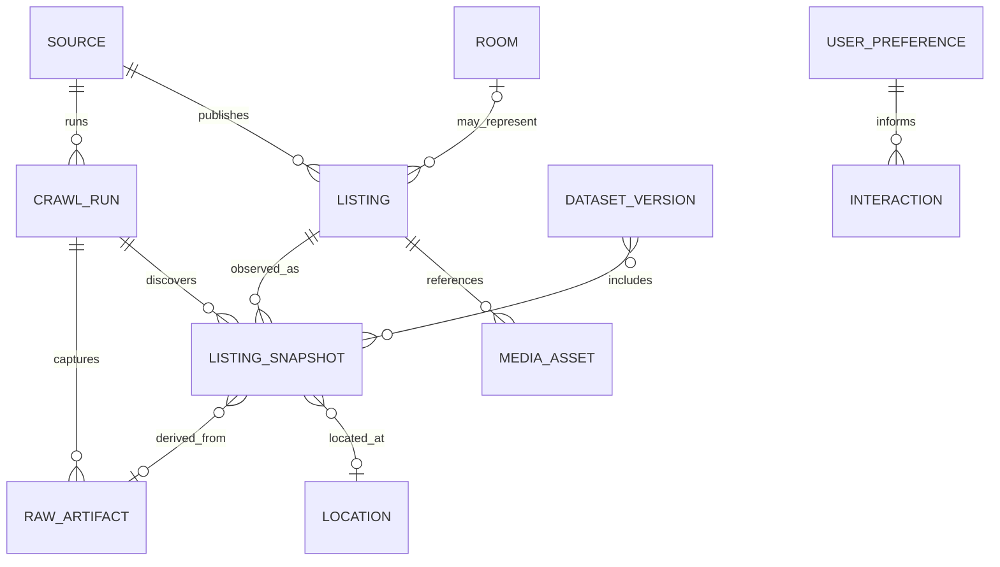

# Mô hình khái niệm và từ điển dữ liệu

> **Trạng thái: mục tiêu, chưa triển khai.** Đây là mô hình khái niệm, không phải DDL hay cam kết về tên cột/schema.

## Các khái niệm

| Khái niệm | Ý nghĩa |
|---|---|
| `Source` | Một website/nền tảng được phê duyệt để khảo sát và thu thập. Danh sách nguồn còn để mở đến khi qua review điều kiện truy cập. |
| `CrawlRun` | Một lần chạy collector với source, thời gian, phiên bản collector, trạng thái và số liệu vận hành. |
| `RawArtifact` | Nội dung nhận được từ nguồn, giữ bất biến theo lần thu thập; có thể là HTML/JSON/text/ảnh hoặc metadata tùy điều kiện nguồn. |
| `Listing` | Một tin đăng tại nguồn. ID nội bộ ổn định nhận diện tin qua các lần crawl khi có thể; URL nguồn và source key được lưu làm bằng chứng nhận diện. |
| `ListingSnapshot` | Một quan sát của tin ở một thời điểm crawl. Lưu nội dung/field đã trích xuất cùng tham chiếu raw artifact, để thấy lịch sử thay đổi. |
| `Room` | Một phòng/căn cho thuê ngoài đời, nếu hệ thống có đủ bằng chứng để gom nhiều tin. Việc liên kết Listing–Room có độ tin cậy và nguồn xác lập; không bắt buộc có ngay từ đầu. |
| `Location` | Vị trí địa chỉ/địa lý đã chuẩn hóa và độ chính xác. Có thể giữ cả văn bản gốc lẫn giá trị chuẩn hóa. |
| `MediaAsset` | Ảnh/media gắn với listing snapshot hoặc listing, kèm nguồn, checksum, quyền lưu trữ và trạng thái xử lý. |
| `UserPreference` | Tiêu chí tìm phòng được khai báo hoặc suy ra từ phiên; giai đoạn đầu có thể ở client/session và không yêu cầu tài khoản. |
| `Interaction` | Sự kiện tối thiểu như impression, click, save, dismiss hoặc contact intent; session identifier không định danh không được dùng để nhận diện cá nhân. |
| `DatasetVersion` | Tập dữ liệu bất biến hoặc có thể tái lập, dùng cho serving/training/evaluation, ghi lại snapshot đầu vào và quy tắc biến đổi. |

## Quan hệ khái niệm

Quan hệ `Room` là tùy chọn, có thể mơ hồ và không được suy ra chỉ từ cùng địa chỉ/ảnh. Entity `UserPreference`/`Interaction` chỉ được lưu tối thiểu cần thiết cho cá nhân hóa; chi tiết product và event contract thuộc tài liệu sản phẩm/API.

## Từ điển field chuẩn hóa

Các field dưới đây là nhóm thông tin mục tiêu. Từng nguồn có thể thiếu field hoặc biểu diễn khác nhau; giá trị gốc luôn được giữ cùng provenance theo chính sách lưu trữ.

| Nhóm | Field/định nghĩa | Kiểu khái niệm | Quy ước |
|---|---|---|---|
| Định danh | source, source listing key, canonical URL, internal listing ID | ID/URL | URL chuẩn hóa không được dùng một mình nếu nguồn tái sử dụng URL; lưu lịch sử URL khi đổi. |
| Thu thập | first seen, last seen, observed at, source published/updated time | timestamp | Lưu UTC; thời điểm nguồn công bố có thể thiếu hoặc không đáng tin. |
| Trạng thái | availability assertion, status evidence, last verified at | enum/timestamp/text | Trạng thái tin và trạng thái phòng thật khác nhau; chỉ gán hết hạn khi có rule/evidence rõ. |
| Giá | asking rent amount/currency/period; deposit; one-time fee | decimal/currency/period | Không gộp tiền cọc vào tiền thuê tháng. Không suy ra giá giao dịch. |
| Phí định kỳ | điện, nước, quản lý, giữ xe, phí khác | amount + unit/basis | Mỗi khoản có thể là mức cố định, theo đơn vị tiêu thụ, khoảng giá hoặc chưa biết. |
| Diện tích | advertised area | decimal + unit | Giữ số gốc và đơn vị; chuẩn hóa về m² khi quy đổi có căn cứ. |
| Loại hình | room, studio, apartment, shared accommodation, other/unknown | enum + raw text | Mapping theo taxonomy có phiên bản; giữ nguyên nhãn nguồn. |
| Vị trí | address text, administrative area, coordinates, precision/confidence | structured/text/geo | Tọa độ suy ra phải có độ tin cậy và phương pháp; không công bố địa chỉ chính xác nếu nguồn/chính sách không cho phép. |
| Tiện ích | amenity key, value, evidence, confidence | multi-valued | Tách `true`, `false`, `unknown`; không hiểu field vắng mặt là false. |
| Nội dung | title, description, contact/action text | text | Nội dung nguyên văn thuộc raw layer; normalized layer phải hạn chế dữ liệu cá nhân. |
| Media | source URL/reference, content hash, mime type, dimensions, fetch status | metadata | Lưu media bytes chỉ sau review quyền lưu, retention và chi phí. |
| Chất lượng | completeness, parse confidence, validation flags | score/flags | Giữ chi tiết lý do; không biến score thành bằng chứng sự thật. |

### Missing, zero và các giá trị đặc biệt

- `unknown`/null biểu thị chưa thu được hoặc không suy ra được; `not_applicable` chỉ dùng khi thuộc tính không áp dụng; `false` chỉ khi nguồn nêu rõ không có.
- Số 0 chỉ hợp lệ nếu đó là giá trị được nguồn khai báo và có nghĩa nghiệp vụ. Giá thuê bằng 0 không được suy đoán là miễn phí.
- Range, “liên hệ”, “thỏa thuận”, miễn phí, bao gồm trong giá cần giữ biểu diễn nguồn và parse status riêng; không ép thành số giả.
- Tiền tệ, chu kỳ thanh toán, đơn vị phí và đơn vị diện tích phải đi cùng con số. Giá chưa quy đổi không được so sánh như cùng đơn vị.

## Định danh và liên kết listing với room

1. Mỗi listing gắn với một source identity; từng snapshot tham chiếu crawl run và raw artifact.
2. Dedup tin cùng nguồn ưu tiên source key ổn định, sau đó URL đã chuẩn hóa; nếu thiếu, dùng fingerprint nội dung/thuộc tính theo phiên bản.
3. Cross-source matching chỉ tạo candidate link. Chỉ tạo/duy trì liên kết listing với room khi rule được đánh giá và có confidence/evidence; cho phép unlink khi thông tin mâu thuẫn.
4. Không xóa snapshot cũ khi giá, ảnh, địa chỉ hoặc trạng thái thay đổi. “Tin biến mất khỏi crawl” chỉ là tín hiệu cần xác minh, không đủ bằng chứng phòng đã hết.

