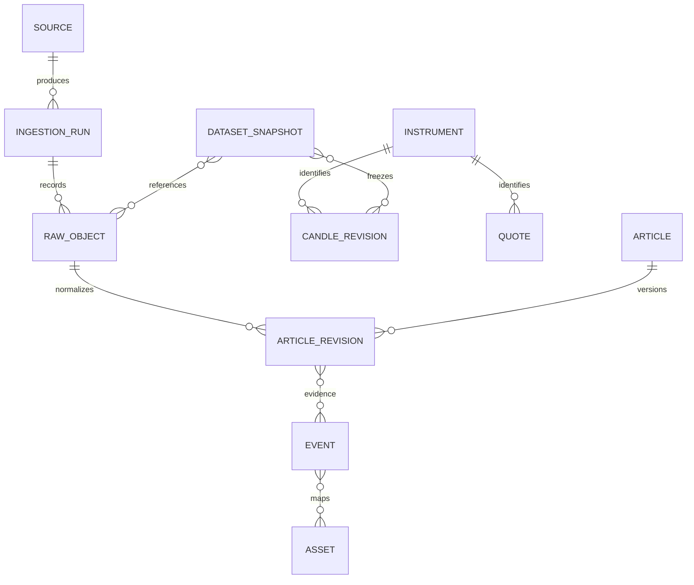

# Entities và data dictionary

**Trạng thái:** logical model mục tiêu; kiểu wire/schema vật lý được khóa khi foundation triển khai. Decimal financial values không dùng binary float cho ledger; dataset numeric ML ghi dtype trong manifest.

## Dictionary chuẩn

| Entity | Trường tối thiểu và quy tắc |
|---|---|
| Source | source_id, provider, product/feed, terms_version/hash, permitted_use_policy_id, evidence flags; không có credential |
| Asset | asset_id, canonical symbol/name; BTC, ETH, USDT là ba assets |
| Instrument | instrument_id, venue, market_type, native_symbol, base_asset_id, quote_asset_id, active_from/to, precision evidence |
| CandleRevision | instrument_id, interval, open_time, close_time, is_closed, OHLC, base_volume, quote_volume nếu có, trade_count nếu có, revision_id, source_object_id, ingested_at, available_at |
| Quote | instrument_id, price/bid/ask theo source payload, event_time, received_at, source; không dùng last trade như bid/ask |
| IngestionRun | run_id, source_id, adapter_version, requested range, started/finished_at, status, checkpoint, counts, error_class |
| RawObject | object_id, source URL an toàn, response metadata cho phép, retrieved_at, content_hash, media/schema version, timestamp_unit, storage_ref, policy_id |
| Article | article_id, source_id, canonical_url/native_id, first_seen_at, lifecycle status |
| ArticleRevision | revision_id, article_id, published_at nullable, source_updated_at nullable, observed_at, available_at, allowed title/summary/text, content_hash, language, parsing_version |
| Event | event_id, type, entity links, confidence, extractor_version, evidence revision IDs, available_at; không thay article gốc |
| DatasetSnapshot | snapshot_id, immutable manifest, content hashes, sources/revisions, time coverage, availability policy, feature version, schema/dtype, policy eligibility |

Natural key nến là venue+market_type+native_symbol+interval+open_time; mỗi sửa đổi tạo revision. Không dùng symbol đơn lẻ làm primary identity. Native strings `BTCUSDT` và `ETHUSDT` là Binance Spot; không tự map mọi sản phẩm có BTC sang cùng series.

Lưu UTC có timezone. UI mặc định Asia/Ho_Chi_Minh và hiển thị timezone. Raw giữ original value/unit/timezone khi được phép; standardized timestamp không xóa bằng chứng ban đầu. Published time thiếu là null, không điền retrieval time dưới tên published_at. Source revisions, ingested_at và available_at là các khái niệm riêng.

Price/candle lịch sử không chứa thông tin portfolio riêng. Dataset manifests không chứa user ledger; scope truy cập snapshot theo source policy và account entitlement khi có.

Account/workspace ownership và experiment delivery theo [API](../09-api/README.md); financial entities và decimal/replay rules theo [portfolio](../07-portfolio/README.md); run/artifact manifest theo [Model Lab](../08-model-lab/README.md). Không tạo bảng ledger/feature định nghĩa thứ hai trong domain market data.
